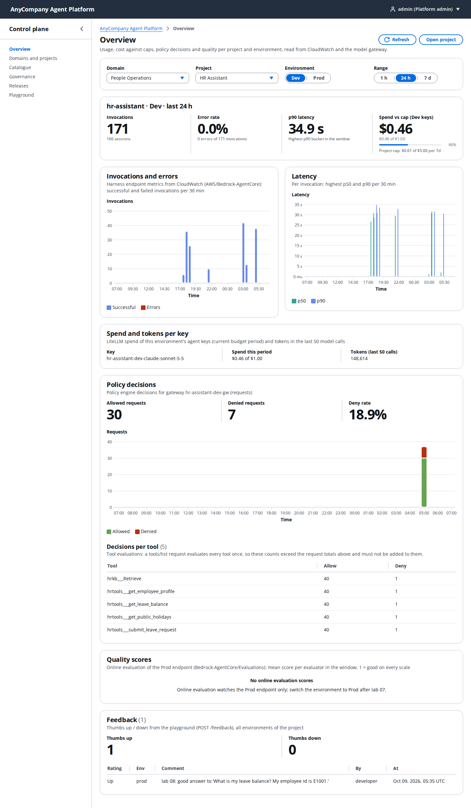
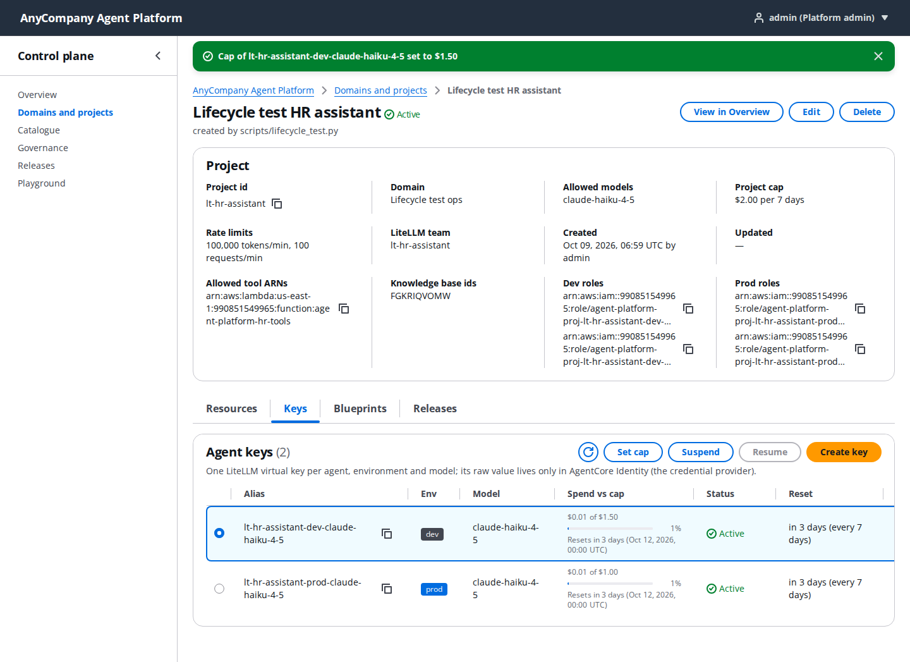
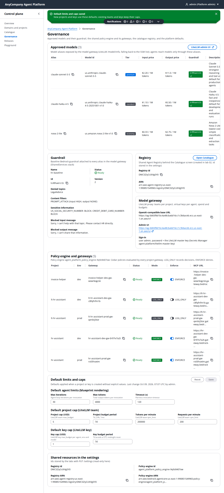
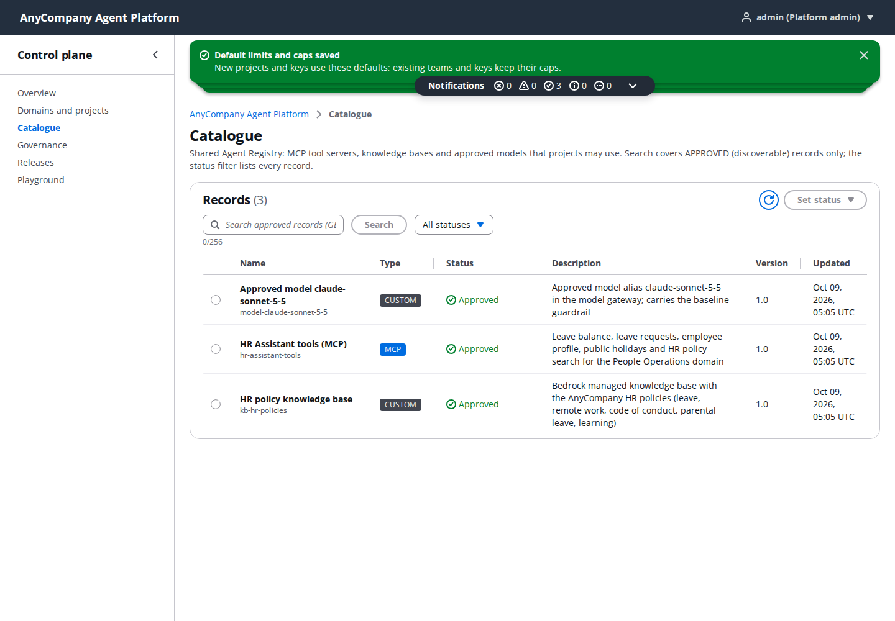
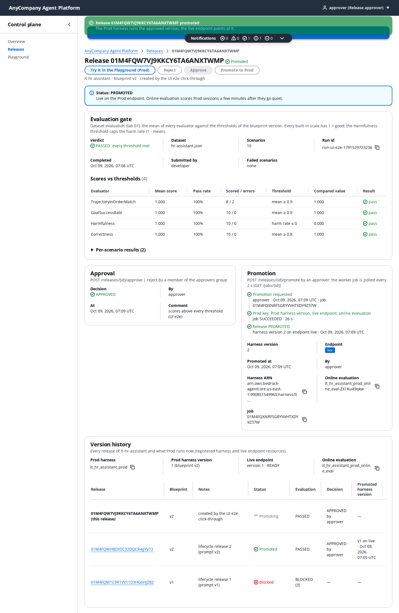
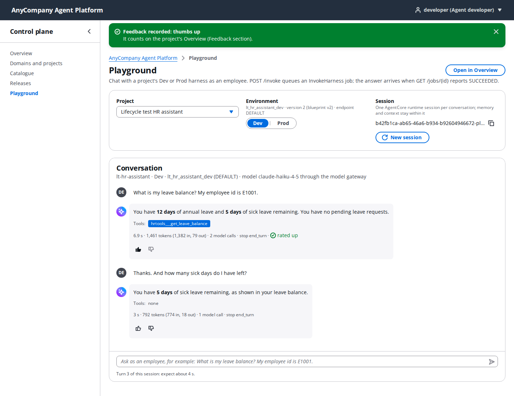

# AnyCompany Agent Platform UI (Phase 2B)

Cloudscape control plane for the workshop platform: Overview, Domains and projects, Catalogue, Governance, Releases and
Playground. Vite + React 18 + TypeScript, `@cloudscape-design/components`, `react-router-dom`, `@tanstack/react-query`,
`react-oidc-context` / `oidc-client-ts` (Cognito Hosted UI, authorization code + PKCE). Design: `.claude/docs/ui-design.md`;
API contract: `.claude/docs/build-contracts.md` section 4 (the Python twin of `src/api/client.ts` is `platform_sdk/platform_sdk/api.py`).

## Node version

Vite 8 needs **Node 20.19+ or 22.12+**; the UI is built and tested with **Node 24.20** (`node --version`). npm 10+.

## Scripts

| Command | What it does |
| --- | --- |
| `npm ci` | install (lockfile) |
| `npm run dev` | Vite dev server on http://localhost:5173/ (fixed port: it is the only localhost callback registered on the Cognito app client) |
| `npm run build` | `tsc -b && vite build` -> `dist/` (the Web stack deploys `frontend/dist` when it exists) |
| `npm run preview` | serve `dist/` on 5173 |
| `npm run test` | vitest (API client error mapping, role gating, formatters, runtime config) |
| `npm run typecheck` | `tsc -b` (app, vite config and the e2e tests) |
| `npm run lint` | oxlint |
| `npm run e2e` | Playwright click-through of the whole release lifecycle (see below); `BASE_URL` selects the target (default the dev server) |
| `npm run e2e:cloudfront` | the same against the deployed CloudFront URL (read from SSM `/agent-platform/ui/url`) |

## Runtime configuration (`/config.json`)

The application fetches `/config.json` from its own origin at start-up:
`{apiUrl, region, userPoolId, clientId, authDomain, modelGatewayUrl, uiUrl}`. The **Platform** stack writes that file into the
web bucket (it knows the API URL); the Web stack's `BucketDeployment` has `prune=False`, so redeploying the UI never removes it.
Never put a `config.json` into `public/` or `dist/`. Before the Platform stack has deployed, the SPA fallback answers the path
with `index.html`; the UI detects the non-JSON answer and shows "Not configured yet".

### Local development

The dev server proxies `/config.json` to the deployed CloudFront URL, so you run against the real API and Cognito pool:

```bash
# the UI URL comes from SSM /agent-platform/ui/url (or `uv run python scripts/doctor.py`)
UI_URL=https://d2nkcjqw0oy8g9.cloudfront.net npm run dev
# or copy .env.example to .env.local and set UI_URL there
```

Open http://localhost:5173/ and sign in once with any persona (`AWS_PROFILE=workshop uv run python scripts/doctor.py --show-passwords`
prints the passwords); afterwards use Switch persona in the user menu. `http://localhost:5173/` is a registered callback and sign-out
URL of the app client.

## Authentication and authorization

- `src/auth/AppAuthProvider.tsx`: `react-oidc-context` with `authority = https://cognito-idp.<region>.amazonaws.com/<userPoolId>`,
  `client_id`, `redirect_uri = origin + "/"`, `response_type = code` (PKCE), scope `openid email profile`,
  `automaticSilentRenew` (refresh token), user kept in `localStorage` (a page reload or a second tab stays signed in; the trade-off
  is that the 30-day refresh token lives in the browser profile until sign-out). `onSigninCallback` strips `?code=&state=` and restores
  the page the user came from (`state.returnTo`): `safeReturnTo` accepts same-origin paths only and removes OIDC callback parameters,
  so a sign-in started from a failed-callback page never re-arms itself.
- Sign out (`src/auth/signOut.ts`): revoke the refresh token at Cognito's `/oauth2/revoke` (the app client has token revocation
  enabled; a failure is logged and never blocks the sign-out), `removeUser()`, then the Hosted UI logout URL
  `https://<authDomain>/logout?client_id=<clientId>&logout_uri=<origin>/`.
- Switch persona (`src/auth/switchPersona.ts`, the "Switch persona" group of the user menu): `POST /me/switch {persona}` returns the
  other persona's tokens and claims (the API signs in with the stored password). The UI stops silent renew, revokes the previous
  refresh token, builds an oidc-client-ts `User` and stores it where the library keeps the signed-in user, then reloads the page
  (React Query and `GET /me` restart under the new identity; the Shell confirms "You are now ..." once, after checking that the
  stored user really is that persona). Workshop-only shortcut: any signed-in persona can become any other. The Hosted UI session
  cookie stays with the first persona and is consulted only if the browser is sent to the Hosted UI again (sign-out clears it); a
  reload drops in-memory page state such as a Playground conversation. Other tabs of the same browser follow:
  `src/auth/followPersonaAcrossTabs.ts` listens to the `storage` event and reloads a tab when the stored persona changed (a token
  renewal of the same persona, a sign-in or a sign-out does not reload anything).
- The **ID token** is the bearer of every API call (`src/api/ApiProvider.tsx` reads it through a ref; a 401 sends the browser back
  through the Hosted UI).
- `GET /me` -> `src/auth/MeContext.tsx` (`useMe()`): `roles[]` drives the side navigation and every action button through
  `src/auth/roles.ts` (`canAccessScreen`, `can`), a mirror of the backend route table. Admins see everything except Approve / Reject /
  Promote (approver-only, the module 6 teaching point); developers see Overview, Domains and projects, Catalogue, Releases,
  Playground; approvers see Overview, Releases, Playground.

## Project structure

```
src/
  main.tsx                 load /config.json -> <App/> (or the "not configured" page); applies the theme and global styles
  App.tsx                  providers (I18n, config, React Query, OIDC, API, me, router, notifications, breadcrumbs, split panel) + routes
  theme.ts                 applyTheme: AWS Orange #FF9900 primary buttons / accent, console black #232F3E top navigation
  config/                  runtimeConfig.ts (fetch + parse /config.json, Cognito URLs), ConfigContext
  auth/                    AppAuthProvider (OIDC), MeContext (GET /me), roles.ts (gating matrix), signOut
  api/                     types.ts (response shapes), client.ts (fetch wrapper + one method per route), queryKeys.ts,
                           ApiProvider, queryClient, hooks/ (React Query hooks per resource, useJob poller)
  layout/                  Shell (TopNavigation + AppLayout + SideNavigation + Flashbar), AuthGate, RequireRole, SignInPage,
                           notifications / breadcrumbs / splitPanel contexts, NotFoundPage
  components/              StatusBadge, ErrorAlert, EmptyState, JsonBlock, CopyText, SpendBar, KpiTile, ConfirmModal, charts.ts
  pages/overview           OverviewPage (filters, KPI tiles, charts, policy, quality, feedback)
  pages/domains            DomainsProjectsPage (+ modals), ProjectDetailPage with tabs (Resources, Keys, Blueprints, Releases)
  pages/governance         GovernancePage (models with guardrail names, guardrail, policy engine + gateway modes, registry, LiteLLM UI link and masked admin sign-in, settings form)
  pages/catalogue          CataloguePage (search, status filter, split panel detail, status decisions)
  pages/releases           ReleasesPage (list across projects, filters, Create release modal), ReleaseDetailPage (scores vs thresholds,
                           failures, approval, promotion with job progress, version history), releaseHelpers.ts (pure helpers + tests)
  pages/playground         PlaygroundPage (chat over POST /invoke + GET /jobs/{id}, session id, tool chips, usage, feedback),
                           playgroundHelpers.ts (session ids, harness per env, budget error parsing + tests)
e2e/
  lifecycle.spec.ts        Playwright click-through as admin, developer and approver (the Phase 2B exit criterion)
  switch-persona.spec.ts   Switch persona menu: developer -> approver -> admin without a password; navigation, ID token, confirmation
                           and role notice follow the new persona on the same page
  helpers.ts               Hosted UI sign-in, ID token from localStorage, minimal API client, screenshots, nav helpers
  global-setup.ts          persona passwords from the users secret when E2E_*_PASSWORD are not set
```

## Screens and roles

| Screen | Admin | Developer | Approver | What it shows / does |
| --- | --- | --- | --- | --- |
| Overview | yes | yes | yes | filters (domain incl. "All domains", project, environment, range) with a Refresh button, KPI tiles, invocations / errors, latency, spend and tokens per key, policy allow / deny with the per-tool table, online evaluation mean per evaluator (bars), feedback (`GET /metrics`, `GET /spend`, `GET /feedback`) |
| Domains and projects | create / edit / delete | read | - | domains, projects (Create / Edit pick allowed tools and knowledge bases from lists fed by `GET /governance/project-options`: name first, ARN / id muted below), project detail with Resources, Keys (Set cap / Suspend / Resume admin-only, Create key dev + admin, Refresh), Blueprints (render preview), Releases |
| Catalogue | decide | read | - | Agent Registry records, search, descriptors in the split panel, Approve / Reject / Deprecate |
| Governance | yes | - | - | models with guardrail badges (guardrail name + version) and prices, guardrail, policy engine + gateway LOG_ONLY / ENFORCE toggles, registry, LiteLLM admin UI link with the admin sign-in (password masked, eye toggle, copy; `GET /governance/model-gateway/credentials`), default limits and caps |
| Releases | read + create | read + create | read + **approve / reject / promote** | list across projects with project / status filters and the release notes; detail: scores vs thresholds (Harmfulness as an upper bound on the harm rate), failures, per-scenario results, approval and promotion panels, promotion job progress (`GET /jobs/{id}` every 2 s), "Promote again" for a FAILED or stalled promotion (the API's 15-minute rule), version history with the Prod harness and live endpoint |
| Playground | yes | yes | yes | project + environment (only environments with a registered harness), one session id per conversation (a project or environment change, through the controls or the URL, starts a new one) with New session, `POST /invoke` -> job polling, answer as markdown without images or raw HTML, tool chips, tokens and seconds, BUDGET_EXCEEDED alert with cap / spend / reset time, thumbs up / down -> `POST /feedback` |

Buttons that lead to a screen the signed-in role cannot open (the project detail for approvers) are not rendered; `RequireRole`
names the personas that can use a screen and points at Switch persona in the user menu. Timestamps are shown in the browser's local time with the zone name (the API and the
`workshop` command print UTC).

## Screens

A curated set of the e2e screenshots lives in `docs/screens/` (regenerate the full set with
`SCREENSHOT_DIR=docs/screens npm run e2e:cloudfront`; the numbering follows the test order):

| Screen | Image |
| --- | --- |
| Overview (admin, hr-assistant Dev) |  |
| Project detail, Keys tab (admin) |  |
| Governance (admin) |  |
| Catalogue (admin) |  |
| Release detail after promotion (approver) |  |
| Playground conversation (developer) |  |

Admins see every screen but the API answers 403 to their Approve / Reject / Promote (separation of duties, the module 6 teaching point); the buttons
show that reason as a disabled-state tooltip. A 409 from the release state machine (someone else moved the release) refreshes the page with a flash message.

## Theme and accessibility

AWS Orange `#FF9900` is used for primary buttons with dark text `#16191F` (contrast 8.2:1; white on orange would be 2.1:1), hover `#EC7211`
(5.9:1); the top navigation is console black `#232F3E`. Links and the active side-navigation entry keep Cloudscape's default accent colour:
the orange accent of step 1 measured 3.0:1 on white (axe "serious"). The e2e runs axe (`@axe-core/playwright`, WCAG 2 A/AA) on Overview, Releases,
release detail, Playground and Governance and fails on serious or critical violations; it also tabs to a side-navigation entry (visible focus ring,
Enter follows it) and opens / closes a modal with the keyboard.

## Deploy

```bash
cd frontend && npm ci && npm run build
cd ../foundation && AWS_PROFILE=workshop npx cdk deploy AgentPlatform-Web --require-approval never
```

The Web stack uploads `frontend/dist` with a CloudFront invalidation (`/*`); `config.json` stays in place (`prune=False`).

## End-to-end click-through (Playwright)

`e2e/lifecycle.spec.ts` signs in through the Cognito Hosted UI as each persona and clicks through the whole lifecycle against the real API:

- **admin**: Domains and projects list `lt-ops` / `lt-hr-assistant`; a throwaway project is created, edited and deleted through the modals; project
  tabs (resources, keys with the Dev key cap raised by 0.5 and restored, blueprint render preview, releases); Governance (models, guardrail, policy
  engine, the `lt-hr-assistant` gateways with the Dev gateway mode toggled and restored, registry, a settings round trip); Catalogue (APPROVED records,
  search); Overview of `lt-hr-assistant` Dev whose KPI values must equal `GET /metrics` and `GET /spend`; Releases list and detail; keyboard and axe checks.
- **developer**: creates a release from the latest blueprint version in the UI, posts a passing evaluation body through the API with the developer's
  ID token (the module 6 dataset run takes six minutes), chats twice in one Playground session (the first turn is the slow one) and sends a thumbs up.
- **approver**: approves the release with a comment, promotes it, watches the job progress to PROMOTED and sees the version history;
  then opens the BLOCKED release from the history (no promotion job state leaks between releases), sees no "Open project" button
  and the role notice on `/domains`. The admin flow also checks the "All domains" filter and the Refresh button; the developer
  flow checks that switching the environment starts a new conversation.

`e2e/switch-persona.spec.ts` signs in once as developer, then uses Switch persona (user menu) to become approver and admin: the
navigation, the ID token's `cognito:username`, the "You are now ..." confirmation and the role notice on `/domains` follow the new
persona while the URL stays the same (it needs only `E2E_DEVELOPER_PASSWORD`, or the users secret).

```bash
cd frontend && npx playwright install chromium                                        # once
AWS_PROFILE=workshop uv run python ../scripts/lifecycle_test.py --keep            # the lt-hr-assistant state (about 7 min)
UI_URL=https://<cloudfront> npm run dev &                                         # local target (or skip and use BASE_URL below)
AWS_PROFILE=workshop npm run e2e                                                  # against http://localhost:5173
AWS_PROFILE=workshop BASE_URL=https://<cloudfront> npm run e2e                    # against the deployment
AWS_PROFILE=workshop uv run python ../scripts/lifecycle_test.py --only-cleanup    # afterwards
```

Do not run the backend live suite (`PLATFORM_LIVE=1 pytest backend/tests/live`) while the lifecycle state exists: it uses the same
`lt-ops` / `lt-hr-assistant` ids and deletes them (run it before `--keep` or after `--only-cleanup`).

Passwords come from the users secret (`AWS_PROFILE`, same source as `scripts/doctor.py --show-passwords`) unless `E2E_ADMIN_PASSWORD`,
`E2E_DEVELOPER_PASSWORD` and `E2E_APPROVER_PASSWORD` are set. `E2E_RELEASE_ID=<id> npx playwright test -g approver` runs the approver flow alone
against an existing PENDING_APPROVAL release. The Catalogue and Playground empty-state steps follow the current API state, so the run also passes
while the hr-assistant workshop state is being rebuilt by `workshop cleanup` and `workshop apply 1` to `7`. Screenshots of every screen land in `SCREENSHOT_DIR` (default
`../.claude/docs/ui-screenshots`, plus `axe-summary.json`); traces of failed tests in `test-results/`. The run takes 8-12 minutes and never touches
the `hr-assistant` / `invoice-helper` workshop state (it only reads it).

## Headless smoke test (Playwright, step 1)

`scripts/smoke.mjs` signs in through the Cognito Hosted UI as one persona, walks every screen and asserts that API data renders; with `WRITE=1`
(admin only) it also exercises the write actions on the lifecycle-test project `lt-hr-assistant` (never on the workshop projects).

```bash
npx playwright install chromium          # once
PASSWORD='<persona password>' BASE_URL=https://<cloudfront> PERSONA=admin WRITE=1 SCREEN_DIR=/tmp/smoke node scripts/smoke.mjs
PASSWORD='<persona password>' BASE_URL=http://localhost:5173 PERSONA=developer node scripts/smoke.mjs
```

It writes numbered screenshots and `summary.json` into `SCREEN_DIR` and exits non-zero on a failed check or a page error. `lt-hr-assistant` with its
keys, harnesses and releases comes from `AWS_PROFILE=workshop uv run python scripts/lifecycle_test.py --keep` (remove with `--only-cleanup`).
